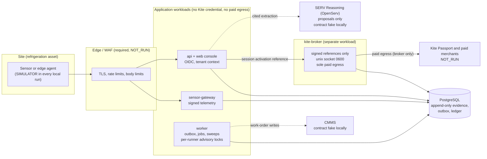
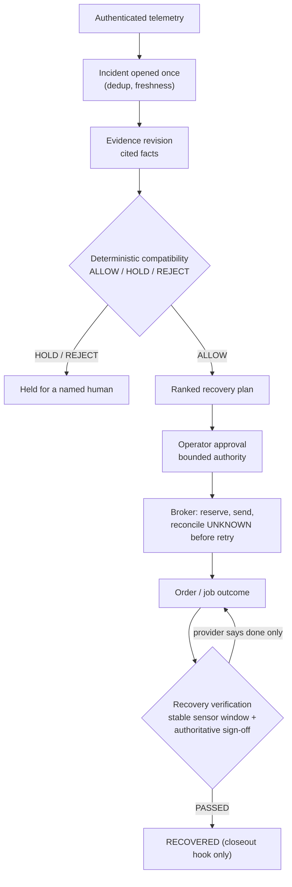
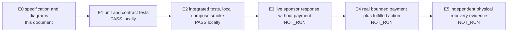

# UptimeBuyer architecture and evidence (DRAFT)

Status: describes the code in this repository. Diagrams are design documentation (evidence level E0); what each part
has actually proven is in the evidence diagram and `claims.json`. Nothing here is a hosted deployment (NOT_RUN).

## Components and trust boundaries

Model output can propose but never approves: compatibility, safety, spending and closure are deterministic code over
recorded evidence. The broker is the only holder of the paid credential and the only paid egress; the API and worker
reach it only through signed, single-use execution references.

## Incident to recovery

## Evidence ladder: what has been shown

The product claim needs E4 and E5; both are NOT_RUN <!-- C-022 C-023 -->. The highest level reached is E2: local
integrated tests and a local production-like compose bring-up <!-- C-011 -->.
